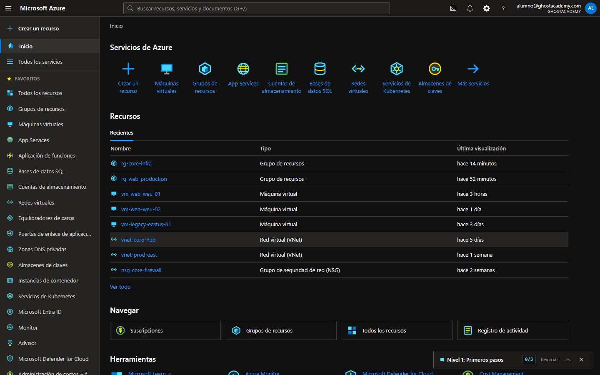
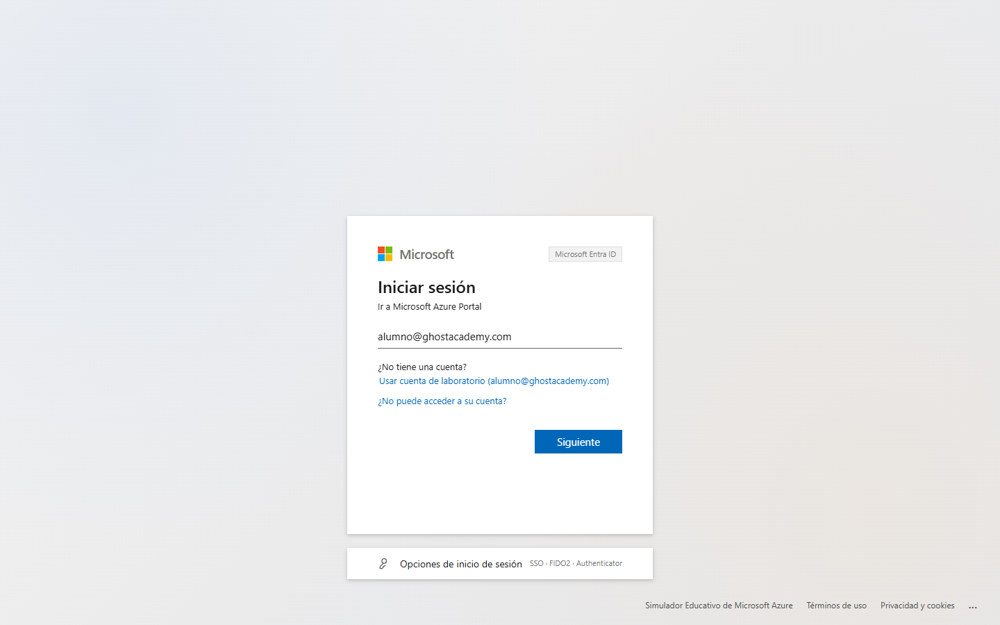
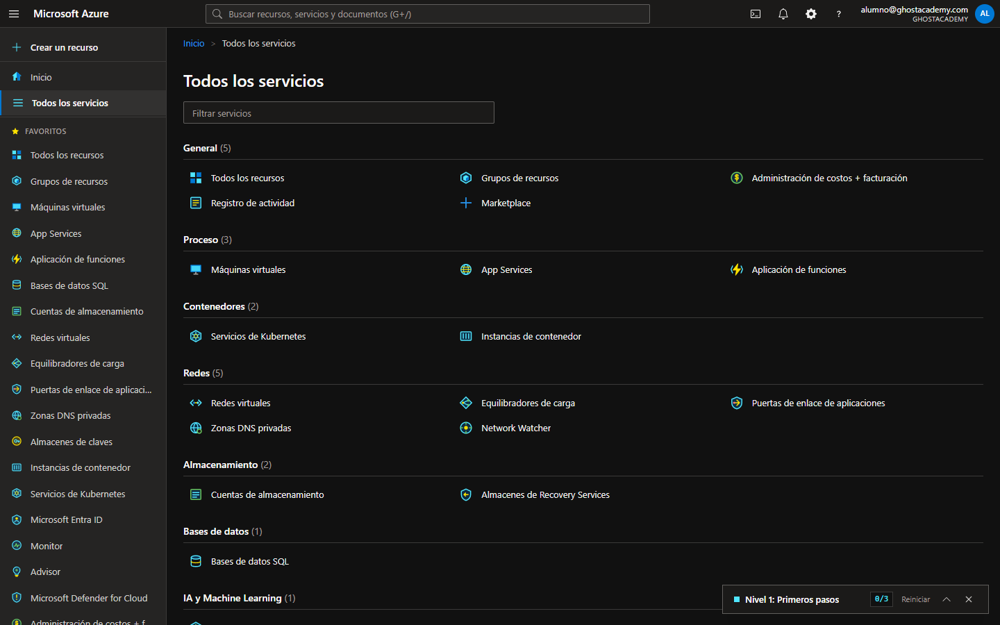
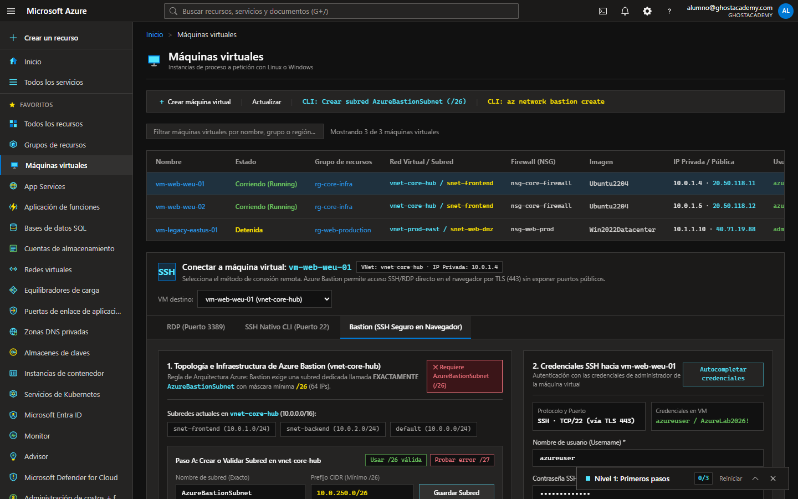
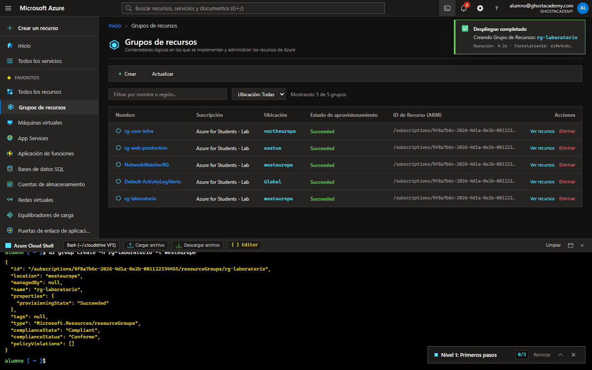
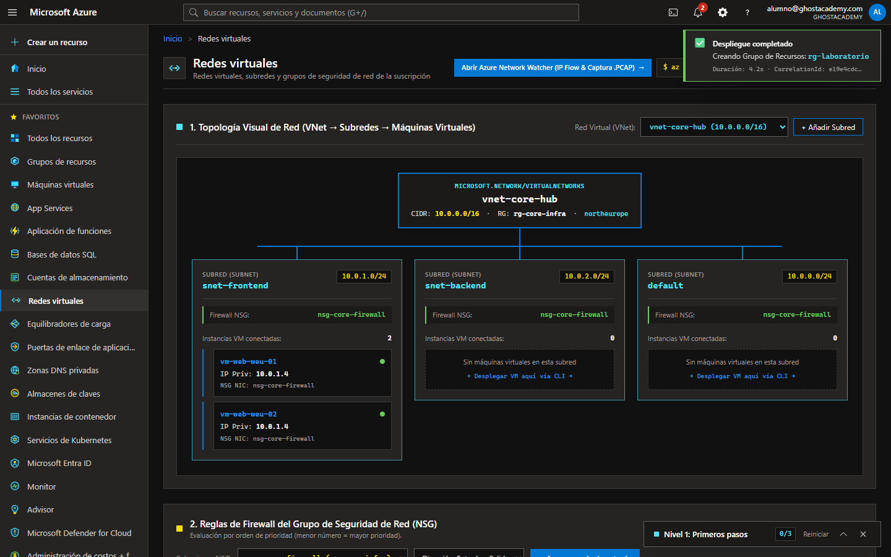
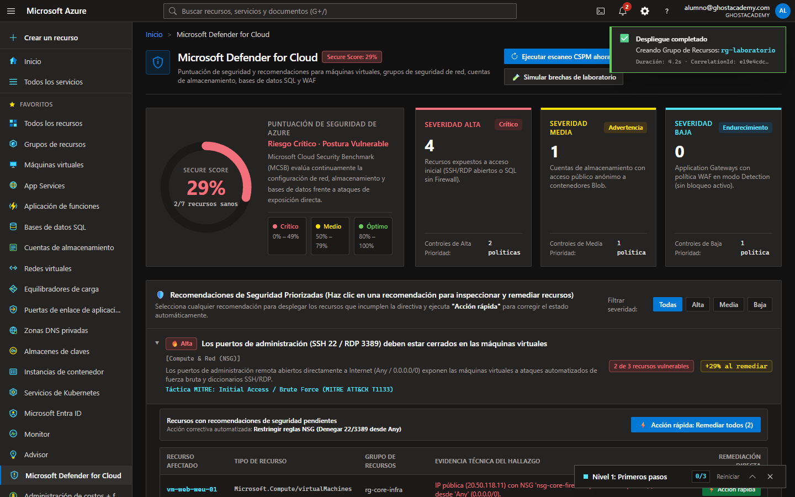
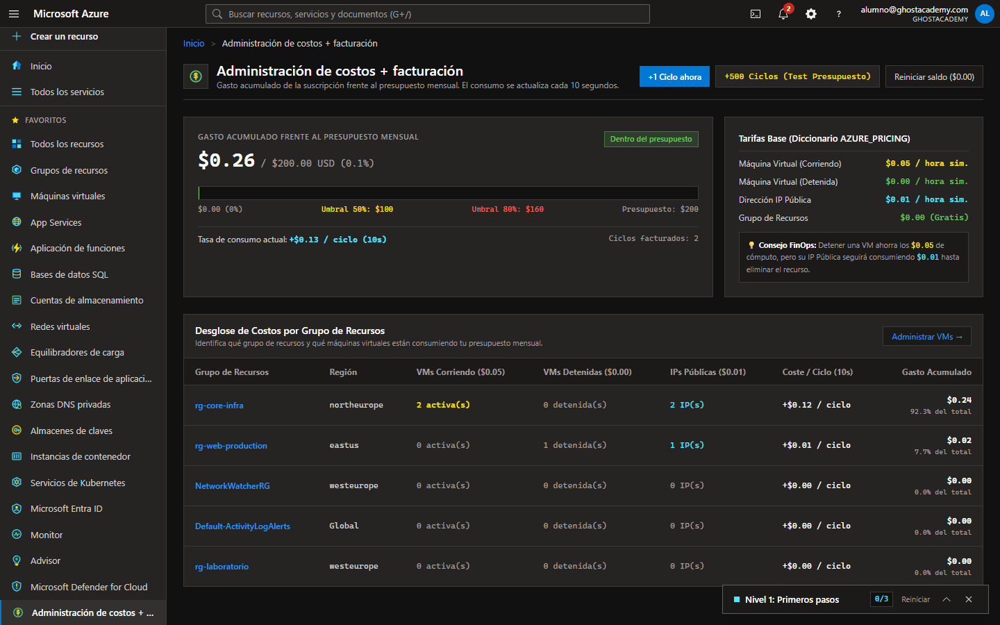
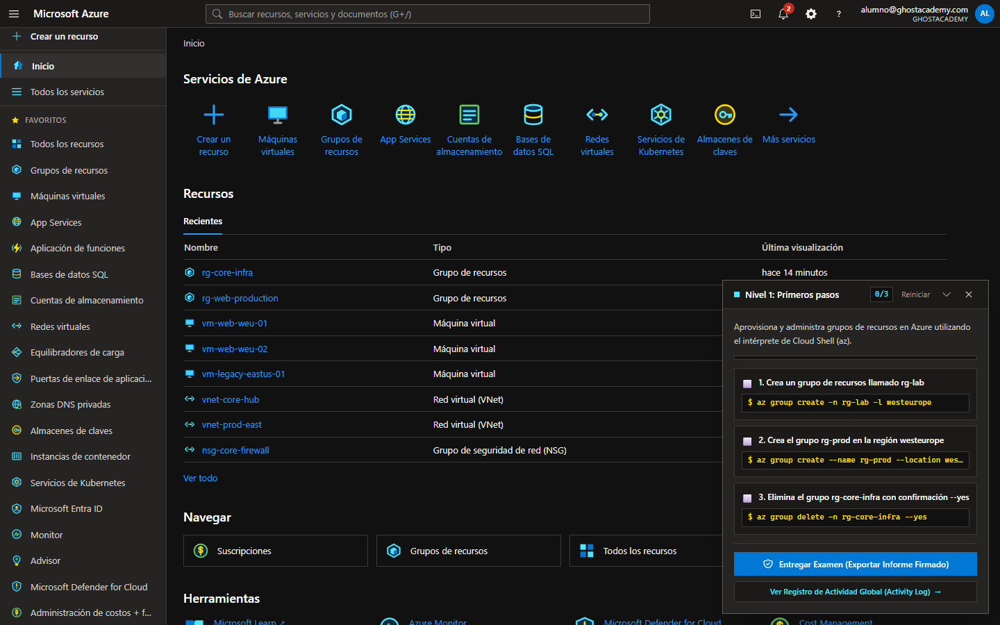

<p align="center">
  <a href="https://www.unfantasmaenelsistema.com"></a>
</p>

<h1 align="center">AzureLab</h1>

<p align="center">
  <b>El portal de Azure dentro del navegador, para practicar sin suscripción ni tarjeta</b><br>
  Portal en español con su menú, su buscador y sus hojas · Cloud Shell con <code>az</code> y <code>kubectl</code> · Redes, máquinas, almacenamiento, identidad, costos y seguridad · Laboratorios que se corrigen solos
</p>

<p align="center">
  <a href="https://unfantasmaenelsistema.github.io/AzureLab/"><b>▶ Abrir en el navegador</b></a> ·
  <a href="#servicios-que-reproduce">Servicios</a> ·
  <a href="#comandos-de-cloud-shell">Cloud Shell</a> ·
  <a href="#uso-en-local">Uso en local</a> ·
  <a href="https://www.unfantasmaenelsistema.com">unfantasmaenelsistema.com</a> ·
  <a href="LICENSE">MIT</a>
</p>

<p align="center">
  
  
  
  
</p>

<p align="center">
  
</p>

AzureLab reproduce el **portal de Microsoft Azure** en español para que el alumnado practique administración en la nube sin crear una suscripción: inicia sesión con Microsoft Entra ID y MFA, recorre el portal con su menú, su buscador global y sus migas de pan, crea recursos desde las hojas o desde **Cloud Shell**, y comprueba el efecto de cada cambio en redes, costos, directivas y seguridad.

La interfaz no lleva marca propia a propósito: cuanto más se parezca al portal real, mejor se traslada después lo aprendido.

> [!NOTE]
> Todo se ejecuta en el navegador, sin servidor ni cuentas. El entorno (recursos, registro de actividad, progreso de los laboratorios) se guarda en el `localStorage` del equipo y se puede exportar e importar como `.json` desde **Configuración**.

> [!IMPORTANT]
> AzureLab es un laboratorio docente independiente, sin relación con Microsoft. La pantalla de inicio de sesión es parte de la práctica y no valida nada: viene rellenada con la cuenta de laboratorio y admite cualquier contraseña, que ni se guarda ni se envía a ningún sitio. **No escribas en ella credenciales reales.**

## Capturas

| | |
| :---: | :---: |
|  Inicio de sesión con Entra ID y MFA |  Todos los servicios |
|  Máquinas virtuales y Bastion |  Cloud Shell |
|  Redes virtuales y NSG |  Defender for Cloud |
|  Costos y presupuesto |  Laboratorios guiados |

## Servicios que reproduce

| Categoría | Servicios y Capacidades Simuladas |
| :--- | :--- |
| **Cómputo y Contenedores** | **Máquinas Virtuales (IaaS)** con asistente multipaso, **Azure Bastion (SSH Web)**, **App Services (PaaS + Kudu)**, **Azure Functions (Serverless JS Sandbox)**, **Container Instances (ACI)** y **Azure Kubernetes Service (AKS)** con `kubectl` integrado. |
| **Redes y Seguridad Perimetral** | **Virtual Networks (VNet)** con cálculo real de rangos IPv4/CIDR y detección de solapamientos (`NetcfgInvalidSubnet`), **Network Security Groups (NSG)**, **Azure Load Balancer (L4)**, **Application Gateway + WAF OWASP (L7)**, **Private DNS Zones** y **Network Watcher** (IP Flow Verify & NSG Diagnostic). |
| **Datos, Almacenamiento y Backups** | **Storage Accounts** con explorador de contenedores Blob, generador de **Tokens SAS (HMAC)**, **Azure SQL Database** con editor de consultas SQL y firewall de IP, y **Recovery Services Vault** con Snapshots *Deep Copy* y restauración *Time Travel*. |
| **Inteligencia Artificial** | **Azure OpenAI Service** + **Azure AI Studio**: generación de claves de API de 32 bytes hex, rotación de claves (`KEY 1` / `KEY 2`), simulador de inferencia HTTP `POST` (`200 OK` vs `401 Unauthorized`) y **Chat Playground**. |
| **Gobernanza, Identidad y FinOps** | **Microsoft Entra ID (IAM / RBAC)** con roles *Owner*, *Contributor* y *Reader*, **Azure Policy** (bloqueo por regiones o etiquetas obligatorias), **Resource Locks** (`CanNotDelete` / `ReadOnly`), **Cost Management + BillingEngine**, **Azure Advisor** y **Defender for Cloud (CSPM)**. |
| **Operaciones Avanzadas y Realismo** | **Ruido de Fondo Empresarial (Enterprise Clutter)** (`NetworkWatcherRG`, `Default-ActivityLogAlerts`, identidades de sistema en Entra ID y eventos automáticos en Activity Log), **Inspector `ARMError`** con `Correlation ID`, **Temas Visuales** (*Azure Oscuro*, *Azure Claro*, *Alto Contraste*), **Menú Acoplado/Flotante** y **Cambio de Directorio (Tenant Switch)**. |
| **Colaboración P2P & PWA** | **Azure Lighthouse** sobre **WebRTC DataChannels** para soporte docente en vivo sin servidor intermedio y empaquetado **PWA Offline-First** (`manifest.json` + `sw.js`) instalable en escritorio. |

---

## Comandos de Cloud Shell

Abre la consola con el icono `>_` de la barra superior. Algunos comandos para empezar:

```bash
# Grupos de Recursos
az group create -n rg-produccion -l westeurope
az group list
az group show -n rg-produccion
az group delete -n rg-produccion --yes

# Redes Virtuales (VNet) y Grupos de Seguridad (NSG)
az network vnet create -n vnet-prod -g rg-produccion --address-prefix 10.20.0.0/16 --subnet-name snet-app --subnet-prefix 10.20.1.0/24
az network nsg create -n nsg-app -g rg-produccion
az network nsg rule create -n Allow-HTTPS --nsg-name nsg-app -g rg-produccion --priority 100 --port 443 --protocol TCP --access Allow

# Máquinas Virtuales
az vm create -n vm-backend-01 -g rg-produccion --image Ubuntu2204 --admin-username azureuser --vnet-name vnet-prod --subnet snet-app --nsg nsg-app
az vm list

# Almacenamiento, Web Apps y Key Vault
az storage account create -n stghostacademylab01 -g rg-produccion -l westeurope --sku Standard_LRS
az appservice plan create -n asp-linux-prod -g rg-produccion --sku B1
az webapp create -n webapp-portal-alumno -g rg-produccion -p asp-linux-prod
az keyvault create -n kv-secretos-prod -g rg-produccion -l westeurope
az keyvault secret set --vault-name kv-secretos-prod -n DbPassword --value SuperSecret2026!

# Kubernetes (AKS) y Sistema de Archivos Persistente (~/.clouddrive)
kubectl get pods -n default
kubectl apply -f deployment.json
ls
touch notas.txt
code notas.txt

# Inferencia contra el Endpoint de Azure OpenAI
curl -X POST https://aoai-ghostacademy-prod.openai.azure.com/openai/deployments/gpt-4o-deployment/chat/completions?api-version=2024-06-01 \
  -H "Content-Type: application/json" \
  -H "api-key: <TU_API_KEY>" \
  -d '{"prompt": "Explica cómo asegurar una VNet con NSG"}'
```

---

## En el aula

- **Laboratorios guiados** (Ayuda › Laboratorios guiados): tareas que se marcan solas al completarlas, con informe de actividad descargable.
- **Rol asignado** (menú de la cuenta): alterna entre *Contributor* y *Reader* para ver qué operaciones bloquea RBAC.
- **Azure Lighthouse** (Ayuda › Sesión remota): el profesorado se conecta por WebRTC al entorno de un alumno para ver sus cambios y darle soporte, sin servidor intermedio.
- **Configuración**: tema oscuro, claro o de alto contraste, menú acoplado o flotante, cambio de directorio y copia de seguridad del entorno.

## Uso en local

No hay nada que compilar: es un único `index.html` con su manifiesto y su *service worker*. Basta con servir la carpeta por HTTP.

```bash
git clone https://github.com/unfantasmaenelsistema/AzureLab.git
```

```bash
python -m http.server 8080 --directory AzureLab
```

Después abre `http://localhost:8080`. La primera carga necesita conexión para descargar Tailwind desde su CDN; a partir de ahí queda en caché y funciona sin conexión.

**Cuenta de laboratorio:** `alumno@ghostacademy.com`, cualquier contraseña y el código MFA que aparece en pantalla.

## Estructura

```text
.
├── index.html            # La aplicación completa (interfaz y motores en JavaScript)
├── manifest.json         # Manifiesto PWA
├── sw.js                 # Service worker (caché para uso sin conexión)
├── icon.svg, *.png       # Iconos
└── docs/capturas/        # Capturas del README
```

## Licencia

[MIT](LICENSE). Microsoft, Azure y Microsoft Entra son marcas de Microsoft Corporation; este proyecto no está afiliado a Microsoft ni cuenta con su respaldo.
