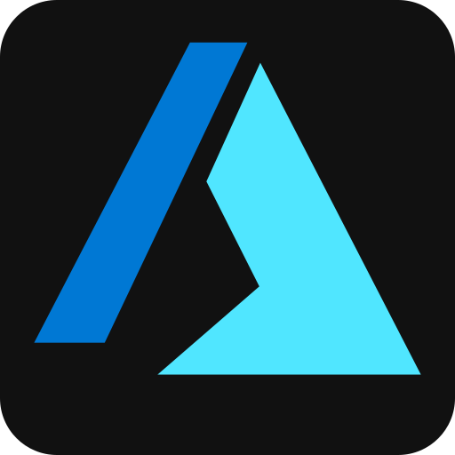
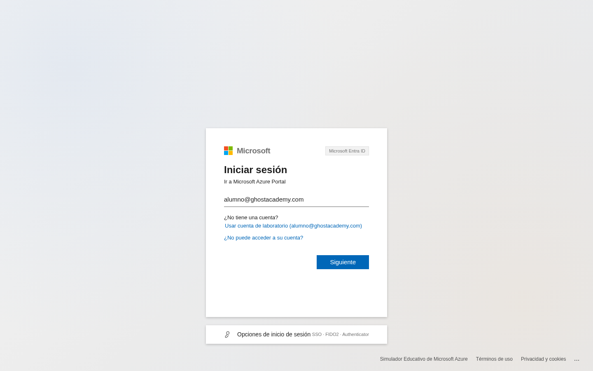
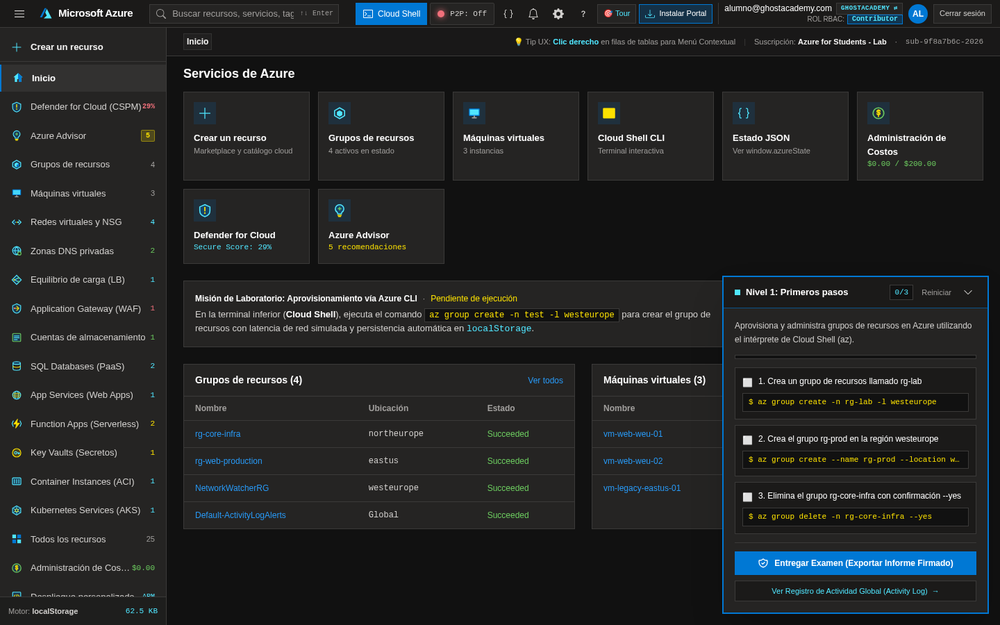
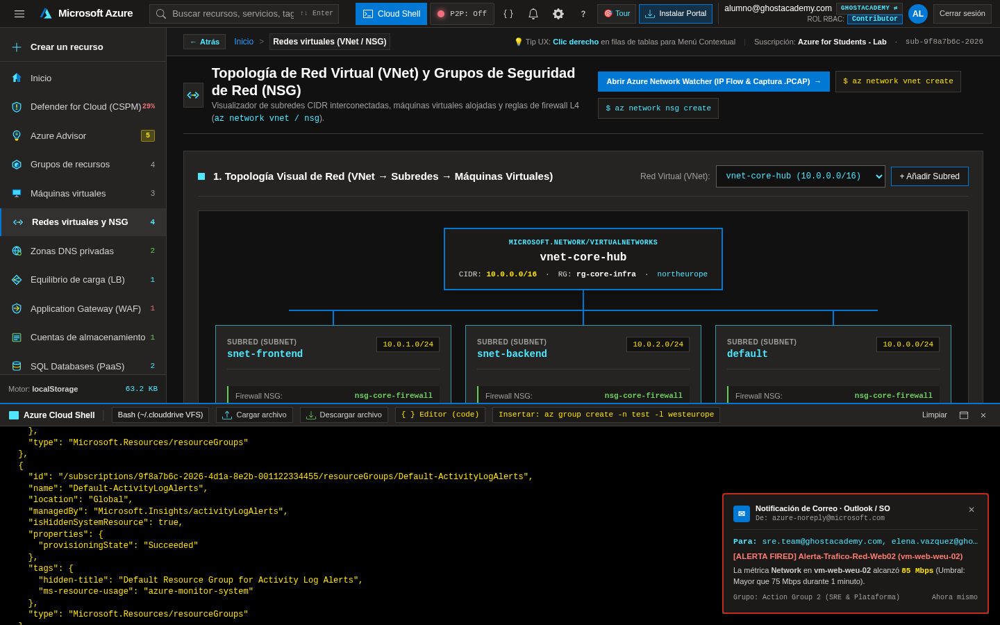
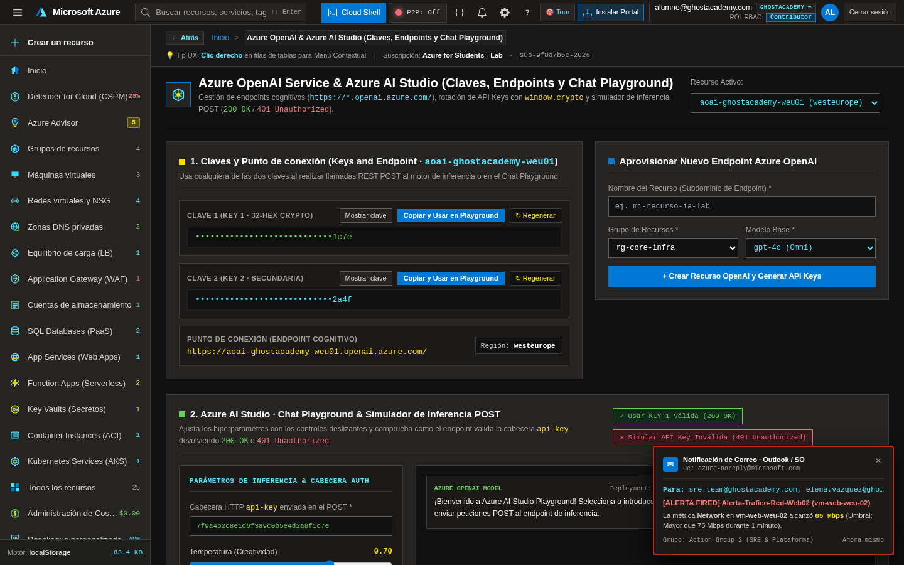
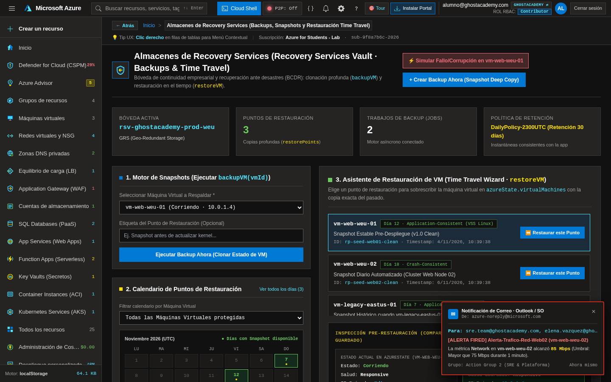
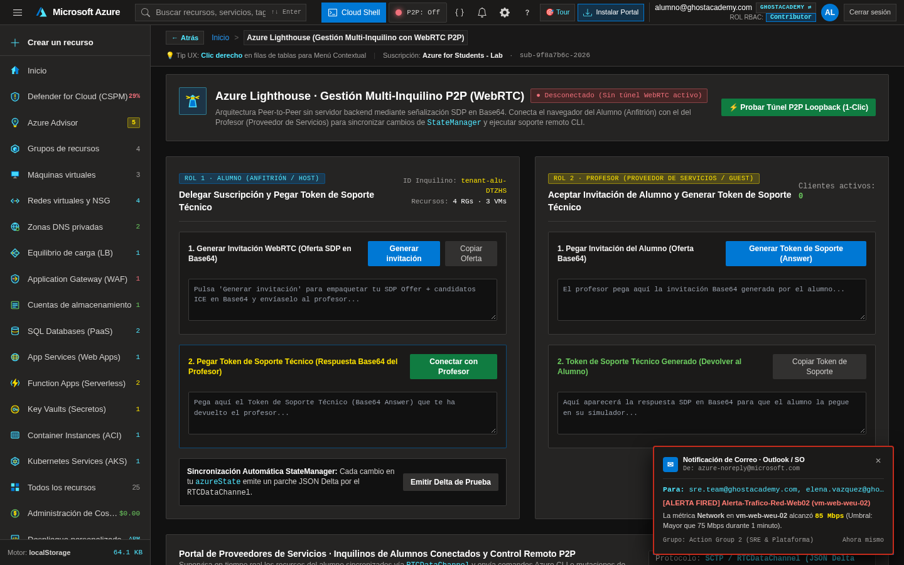
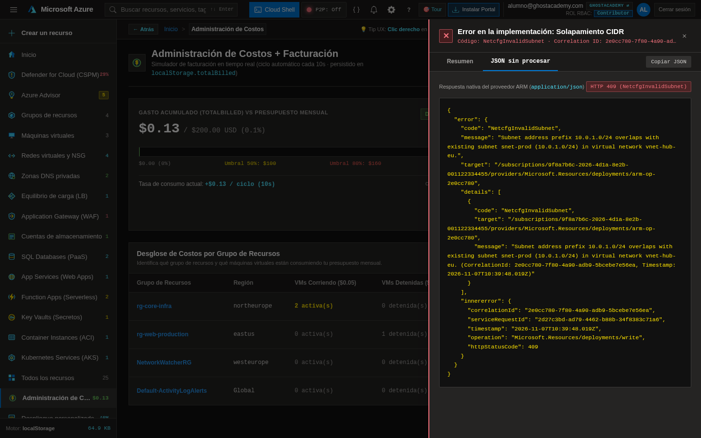

# ☁️ Simulador Educativo de Microsoft Azure (GhostAcademy Edition)

<p align="center">
  
</p>

<p align="center">
  <strong>Entorno interactivo 100% cliente (Zero-Backend) para el aprendizaje práctico de Microsoft Azure, Cloud Shell (CLI), Redes Virtuales, Kubernetes (AKS), Ciberseguridad (WAF/CSPM), FinOps, Azure OpenAI y Gestión Multi-Inquilino (WebRTC P2P).</strong>
</p>

<p align="center">
  
  
  
  
  
  
</p>

---

## 📖 Descripción General

El **Simulador Educativo de Microsoft Azure** es una réplica hiperrealista del portal oficial de **Microsoft Azure (`portal.azure.com`)** y **Azure Cloud Shell**, diseñada específicamente para laboratorios docentes de administración cloud, arquitecturas de red, seguridad perimetral y evaluación práctica sin necesidad de tarjeta de crédito ni suscripción real en la nube.

Toda la lógica de estado (`window.azureState`), validaciones de red CIDR, motor de políticas (**Azure Policy**), control de acceso basado en roles (**RBAC**), facturación en vivo (**BillingEngine**), copias de seguridad profundas (**Recovery Services Vault**), inferencia simulada (**Azure OpenAI Studio**) y telemetría entre alumno y profesor (**Azure Lighthouse vía WebRTC**) se ejecuta **100% en el navegador** con persistencia en `localStorage` y soporte **100% Offline** mediante Service Worker (**PWA**).

---

## 📸 Capturas Reales de la Aplicación

### 1. Puerta de Entrada: Microsoft Entra ID (`login.microsoftonline.com`) + MFA
Réplica del flujo de autenticación corporativa en 3 pasos (Correo electrónico, Contraseña y desafío MFA de 6 dígitos / Notificación Push de Microsoft Authenticator).



---

### 2. Panel Principal del Portal de Azure + Misiones de Azure Academy
Vista general del portal en tema **Azure Oscuro (`#111111`)**, accesos directos a servicios, contadores dinámicos, estado de salud y el panel flotante de misiones autoevaluables con firma criptográfica **SHA-256**.



---

### 3. Topología de Red Interactiva (VNet / Subredes / NSG) y Azure Cloud Shell (CLI)
 Lienzo visual de redes virtuales con validación matemática CIDR en tiempo real y terminal integrada **Azure Cloud Shell** (`Bash` / `AzureCLIParser`) ejecutando comandos `az` sincronizados bidireccionalmente con la interfaz gráfica.



---

### 4. Azure OpenAI & Portal Dedicado Azure AI Studio (Chat Playground)
Gestión de recursos cognitivos con generación criptográfica de **API Keys (`window.crypto`)**, endpoints HTTPS dedicados, ejemplos de consumo con `curl` y **Chat Playground** interactivo con control de *System Prompt*, *Temperatura* y *Tokens máximos*.



---

### 5. Almacenes de Recovery Services (Motor de Snapshots Deep Copy y Time Travel)
Bóveda de copias de seguridad con tabla asíncrona de **Backup Jobs** (*En cola*, *En progreso*, *Completado*), clonación profunda (`structuredClone`) de máquinas virtuales y **Asistente de Restauración con Calendario** para viajar en el tiempo al estado exacto de un punto de restauración.



---

### 6. Azure Lighthouse (Gestión Multi-Inquilino P2P con WebRTC sin Backend)
Conexión directa **Peer-to-Peer (`RTCPeerConnection` + `RTCDataChannel`)** mediante señalización manual en Base64 entre el navegador del alumno (Anfitrión) y el del profesor (Proveedor de soporte), con sincronización de estado en tiempo real y consola de ejecución remota.



---

### 7. Administración de Costos (FinOps) e Inspector de Errores Nativos ARM (`Raw JSON`)
Motor de facturación por ciclos con alertas de presupuesto e inspector lateral de errores de **Azure Resource Manager (`ARMError`)** con `Correlation ID (UUID v4)`, pestaña de resumen guiado y bloque **JSON sin procesar** idéntico al de Azure real.



---

## 🚀 Características y Módulos Principales

| Categoría | Servicios y Capacidades Simuladas |
| :--- | :--- |
| **Cómputo y Contenedores** | **Máquinas Virtuales (IaaS)** con asistente multipaso, **Azure Bastion (SSH Web)**, **App Services (PaaS + Kudu)**, **Azure Functions (Serverless JS Sandbox)**, **Container Instances (ACI)** y **Azure Kubernetes Service (AKS)** con `kubectl` integrado. |
| **Redes y Seguridad Perimetral** | **Virtual Networks (VNet)** con cálculo real de rangos IPv4/CIDR y detección de solapamientos (`NetcfgInvalidSubnet`), **Network Security Groups (NSG)**, **Azure Load Balancer (L4)**, **Application Gateway + WAF OWASP (L7)**, **Private DNS Zones** y **Network Watcher** (IP Flow Verify & NSG Diagnostic). |
| **Datos, Almacenamiento y Backups** | **Storage Accounts** con explorador de contenedores Blob, generador de **Tokens SAS (HMAC)**, **Azure SQL Database** con editor de consultas SQL y firewall de IP, y **Recovery Services Vault** con Snapshots *Deep Copy* y restauración *Time Travel*. |
| **Inteligencia Artificial** | **Azure OpenAI Service** + **Azure AI Studio**: generación de claves de API de 32 bytes hex, rotación de claves (`KEY 1` / `KEY 2`), simulador de inferencia HTTP `POST` (`200 OK` vs `401 Unauthorized`) y **Chat Playground**. |
| **Gobernanza, Identidad y FinOps** | **Microsoft Entra ID (IAM / RBAC)** con roles *Owner*, *Contributor* y *Reader*, **Azure Policy** (bloqueo por regiones o etiquetas obligatorias), **Resource Locks** (`CanNotDelete` / `ReadOnly`), **Cost Management + BillingEngine**, **Azure Advisor** y **Defender for Cloud (CSPM)**. |
| **Operaciones Avanzadas y Realismo** | **Ruido de Fondo Empresarial (Enterprise Clutter)** (`NetworkWatcherRG`, `Default-ActivityLogAlerts`, identidades de sistema en Entra ID y eventos automáticos en Activity Log), **Inspector `ARMError`** con `Correlation ID`, **Temas Visuales** (*Azure Oscuro*, *Azure Claro*, *Alto Contraste*), **Menú Acoplado/Flotante** y **Cambio de Directorio (Tenant Switch)**. |
| **Colaboración P2P & PWA** | **Azure Lighthouse** sobre **WebRTC DataChannels** para soporte docente en vivo sin servidor intermedio y empaquetado **PWA Offline-First** (`manifest.json` + `sw.js`) instalable en escritorio. |

---

## 💻 Comandos Soportados en Azure Cloud Shell

Abre la consola integrada pulsando el icono `>_` de la barra superior y prueba cualquiera de los siguientes comandos:

```bash
# Grupos de Recursos
az group create -n rg-produccion -l westeurope
az group list
az group show -n rg-produccion
az group delete -n rg-produccion --yes

# Redes Virtuales (VNet) y Grupos de Seguridad (NSG)
az network vnet create -n vnet-prod -g rg-produccion --address-prefix 10.20.0.0/16 --subnet-name snet-app --subnet-prefix 10.20.1.0/24
az network nsg create -n nsg-app -g rg-produccion
az network nsg rule create -n Allow-HTTPS --nsg-name nsg-app -g rg-produccion --priority 100 --port 443 --protocol TCP --access Allow

# Máquinas Virtuales
az vm create -n vm-backend-01 -g rg-produccion --image Ubuntu2204 --admin-username azureuser --vnet-name vnet-prod --subnet snet-app --nsg nsg-app
az vm list

# Almacenamiento, Web Apps y Key Vault
az storage account create -n stghostacademylab01 -g rg-produccion -l westeurope --sku Standard_LRS
az appservice plan create -n asp-linux-prod -g rg-produccion --sku B1
az webapp create -n webapp-portal-alumno -g rg-produccion -p asp-linux-prod
az keyvault create -n kv-secretos-prod -g rg-produccion -l westeurope
az keyvault secret set --vault-name kv-secretos-prod -n DbPassword --value SuperSecret2026!

# Kubernetes (AKS) y Sistema de Archivos Persistente (~/.clouddrive)
kubectl get pods -n default
kubectl apply -f deployment.json
ls
touch notas.txt
code notas.txt

# Inferencia contra el Endpoint de Azure OpenAI
curl -X POST https://aoai-ghostacademy-prod.openai.azure.com/openai/deployments/gpt-4o-deployment/chat/completions?api-version=2024-06-01 \
  -H "Content-Type: application/json" \
  -H "api-key: <TU_API_KEY>" \
  -d '{"prompt": "Explica cómo asegurar una VNet con NSG"}'
```

---

## 🛠️ Instalación y Uso Local

### Requisitos previos
- **Node.js** `>= 18.x` (o **Bun** / cualquier servidor HTTP estático).

### 1. Clonar el repositorio
```bash
git clone https://github.com/tu-usuario/microsoft-azure-educational-simulator.git
cd microsoft-azure-educational-simulator
```

### 2. Instalar dependencias y arrancar el servidor de desarrollo
```bash
npm install
npm run dev
```
La aplicación estará disponible en `http://localhost:3000`.

### 3. Compilar para producción (GitHub Pages / Vercel / Netlify)
```bash
npm run build
npm run preview
```

---

## 📁 Estructura del Proyecto

```text
.
├── docs/
│   └── screenshots/                    # Capturas reales de alta resolución del simulador
│       ├── 01-microsoft-entra-login.png
│       ├── 02-portal-home-dashboard.png
│       ├── 03-networking-topology-cloudshell.png
│       ├── 04-azure-ai-studio-playground.png
│       ├── 05-recovery-services-vault.png
│       ├── 06-azure-lighthouse-p2p.png
│       └── 07-cost-management-arm-error.png
├── public/
│   ├── icon.svg                        # Icono vectorial oficial del simulador
│   ├── pwa-192x192.png                 # Icono PWA estándar (192x192)
│   ├── pwa-512x512.png                 # Icono PWA de alta densidad (512x512)
│   ├── pwa-maskable-512x512.png        # Icono PWA adaptable (Maskable)
│   ├── apple-touch-icon.png            # Icono para dispositivos iOS/macOS
│   ├── manifest.json                   # Web App Manifest (display: standalone, theme: #111111)
│   └── sw.js                           # Service Worker Offline-First (Cache-First + Stale-While-Revalidate)
├── index.html                          # Núcleo completo del simulador (UI + Motores Vanilla ES6 JS)
├── manifest.json                       # Manifiesto PWA en raíz
├── sw.js                               # Service Worker en raíz
├── package.json                        # Scripts de construcción y metadatos del proyecto
├── vite.config.ts                      # Configuración de empaquetado con Vite
└── LICENSE                             # Licencia MIT
```

---

## 🔐 Credenciales de Laboratorio por Defecto

- **Usuario (Correo electrónico):** `alumno@ghostacademy.com`
- **Contraseña:** Cualquier contraseña no vacía (ej. `AzureCloud2026!`)
- **Código MFA (6 dígitos):** Se muestra en pantalla en el simulador de *Microsoft Authenticator* o puedes pulsar **"Autocompletar código"** / **"Aprobar notificación Push"**.

---

## 📄 Licencia

Distribuido bajo la licencia **MIT**. Consulta el archivo [`LICENSE`](./LICENSE) para más detalles.
